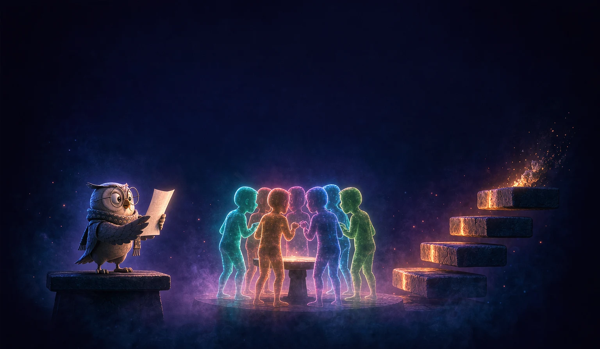

<p align="center">
  
</p>

<h1 align="center">ten-step-working-knowledge</h1>

<p align="center"><strong>Turn an unfamiliar topic into working knowledge in four movements.</strong></p>

<p align="center">
  <a href="LICENSE.md"></a>
  
  
</p>

An agent skill for learning a field fast enough to speak and act in it.

The agent argues with itself. Then it examines you.

## Why

Ask an AI "tell me about X". You get the median view.

That is the most common framing, the surface layer, the answer that offends no one. You finish the chat feeling informed. Two weeks later you cannot defend a single claim.

Reading produces familiarity. Only retrieval produces knowledge.

This skill is the protocol for the difference.

## What it does

- **Five experts disagree.** A practitioner, a scholar, a skeptic, an economist, and a historian. Each must produce one claim the other four would never make.
- **The agent attacks its own brief.** Every finding carries a confidence score and the evidence that would lower it.
- **The agent examines you.** Ten questions, easy to expert, one at a time, scored honestly, with a follow-up on the same point when you miss.
- **The agent refuses to flatter.** A failed gate stays failed. "Great job" is prohibited.

## The method

| Movement | Steps | Job | Exit condition |
|---|---|---|---|
| **I. Map** | 1–4 | Find the door: what the field actually looks like | You can say who is fighting whom, and why |
| **II. Ladder** | 5–7 | Get in: a route, five rungs, twenty hours | You did real work, not read about it |
| **III. Forge** | 8–9 | Know it: retrieval under pressure, then teach-back | You pass an exam and explain it clean |
| **IV. Carry** | 10 | Keep it: compress into one cheat sheet | The cheat sheet works without the course |

The ten steps:

1. Five Lenses — five experts, five incompatible answers
2. The Argument — a contradiction list, including the silences
3. The Brief — one page, ranked by reliability
4. The Knife — the agent attacks its own brief
5. Five Resources, Not Five Hundred — a decision, not a reading list
6. The Ladder — five rungs, each one tiptoe away
7. The First Twenty Hours — the 20% that produces 80%
8. The Examiner — ten questions, one at a time
9. The Twelve-Year-Old — the Feynman test, with no skipped links
10. The Cheat Sheet — one page that works without the course

## Install

One command, any host that supports the Agent Skills standard:

```bash
npx skills add epslkslsksndnsjs-lab/ten-step-working-knowledge
```

Or clone it into your skills root:

```bash
git clone https://github.com/epslkslsksndnsjs-lab/ten-step-working-knowledge.git \
  ~/.claude/skills/ten-step-working-knowledge
```

Other skill roots:

| Host | Path |
|---|---|
| Claude Code | `~/.claude/skills/` |
| Cross-agent | `~/.agents/skills/` |
| Codex | `~/.codex/skills/` |
| WorkBuddy | `~/.workbuddy/skills/` |

The skill needs web search and file writes. It has no scripts, no dependencies, and no API keys.

## Use it

Name the skill, or describe the situation:

> Use ten-step-working-knowledge. Topic: pricing a hardware product for a first-time founder. I have 20 hours. Full run.

The agent asks three questions, then starts step 1:

1. What is the topic, and what is your role in it?
2. How many hours do you actually have?
3. Full run, or map only?

## What a run leaves behind

One folder per topic, one file per step, so a run can resume after an interruption:

```
pricing-hardware/
├── 01-five-lenses.md
├── 02-contradictions.md
├── 03-brief.md
├── 04-knife.md
├── 05-resources.md
├── 06-ladder.md
├── 07-twenty-hours.md
├── 08-exam-log.md
├── 09-teachback.md
└── 10-cheatsheet.md
```

## Design rules

- **Caps are absolute.** Five perspectives, five resources, five levels, ten lessons, ten exam questions, one cheat sheet. The cap is the method.
- **Every step has a gate.** A gate is a test, not a checklist. It either passes or the step repeats.
- **Uncertainty is stated in place.** The agent writes "I could not verify this", not a hedge that hides the doubt.
- **The learner does the retrieval.** A teach-back written by the agent does not count.

## Repository layout

```
.
├── SKILL.md              # The skill: philosophy, method, rules, assumptions, metaphors, principles
├── README.md             # This file
├── CHANGELOG.md          # Release history
├── LICENSE.md            # MIT
└── docs/
    └── assets/
        └── banner.webp   # Hero image
```

## Lineage

The protocol is assembled, not invented.

Movement I adapts multi-perspective question asking from STORM (Stanford OVAL, NAACL 2024), including its two known failure modes. Step 6 draws on Vygotsky's zone of proximal development. Step 8 draws on the testing effect. Step 9 is the Feynman technique. Step 7 is Pareto, bounded to twenty hours. Step 10 is chunking.

The sequence, the caps, and the gates are the contribution.

## License

MIT. See [LICENSE.md](LICENSE.md).
